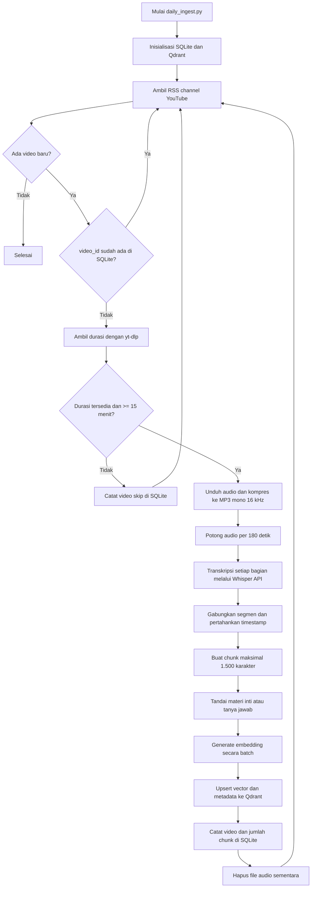
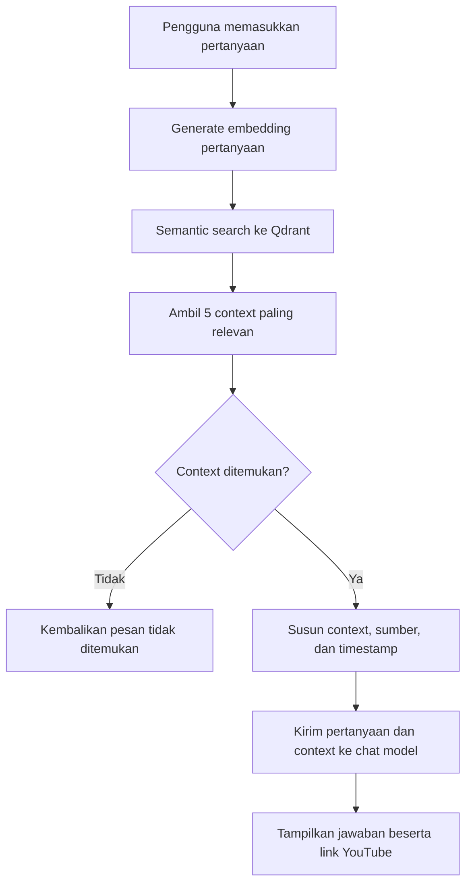

# RAG Kajian Ustadz Khalid Basalamah

Pipeline Retrieval-Augmented Generation (RAG) untuk mengindeks kajian dari
channel YouTube Ustadz Khalid Basalamah, lalu menjawab pertanyaan berdasarkan
transkrip yang paling relevan.

Project ini menggunakan:

- RSS YouTube untuk menemukan video baru.
- `yt-dlp` dan FFmpeg untuk mengambil serta mengompres audio.
- Kenari API-compatible endpoint untuk transkripsi Whisper, embedding, dan
  pembuatan jawaban.
- SQLite untuk mencatat video yang sudah diproses.
- Qdrant untuk menyimpan dan mencari vector embedding.

## Fitur utama

- Memproses video baru secara incremental berdasarkan `video_id`.
- Melewati video yang tidak tersedia atau berdurasi kurang dari 15 menit.
- Memecah audio panjang menjadi bagian maksimal 180 detik sebelum dikirim ke
  API transkripsi, serta menghindari request terakhir yang nyaris kosong akibat
  padding encoder MP3.
- Membuat chunk transkrip maksimal sekitar 1.500 karakter dengan overlap dua
  segmen.
- Mendeteksi bagian materi inti dan sesi tanya jawab.
- Menyimpan metadata sumber, timestamp, dan link YouTube pada setiap vector.
- Menjawab pertanyaan dengan menyertakan sumber video dan timestamp.
- Mengenkripsi API token menggunakan Fernet; encryption key disimpan terpisah
  dari ciphertext.

## Arsitektur dan flow proses

### Flow ingest kajian



### Flow tanya jawab



## Prasyarat

- Python 3.10+ (project saat ini diuji pada Python 3.12).
- FFmpeg dan `ffprobe` tersedia di `PATH`.
- Docker (opsional, jika Qdrant dijalankan secara lokal).
- API key Kenari dengan akses ke endpoint transcription, embeddings, dan chat.
- Koneksi internet untuk RSS YouTube, YouTube, dan Kenari API.

## Instalasi

```bash
git clone <url-repository>
cd rag-kajian

python -m venv venv
source venv/bin/activate       # Linux/macOS
# venv\Scripts\activate        # Windows PowerShell

pip install -r requirements.txt
```

Pastikan dependency sistem tersedia:

```bash
ffmpeg -version
ffprobe -version
yt-dlp --version
```

## Menjalankan Qdrant lokal

Default aplikasi mengarah ke `http://localhost:6333`. Salah satu cara
menjalankan Qdrant:

```bash
docker run --rm \
  -p 6333:6333 \
  -v "$(pwd)/qdrant_storage:/qdrant/storage" \
  qdrant/qdrant
```

Biarkan container berjalan selama proses ingest atau query.

## Konfigurasi environment

Buat file `.env` di root project. File ini sudah di-ignore oleh Git.

```dotenv
# Wajib: Fernet key dan ciphertext API token
TOKEN_ENCRYPTION_KEY=
KENARI_API_KEY_ENCRYPTED=

# Opsional: endpoint Kenari
KENARI_BASE_URL=https://api.kenari.id/v1
KENARI_TRANSCRIPTION_MODEL=whisper-large-v3-turbo
KENARI_EMBEDDING_MODEL=bge-m3
KENARI_CHAT_MODEL=kenari-free
KENARI_EMBEDDING_DIM=1024

# Opsional: Qdrant
QDRANT_URL=http://localhost:6333
COLLECTION_NAME=kajian_khalid_basalamah
```

### Membuat key dan mengenkripsi API token

`TOKEN_ENCRYPTION_KEY` harus disimpan terpisah dari
`KENARI_API_KEY_ENCRYPTED`. Contoh berikut mencetak key dan ciphertext; simpan
hasilnya ke secret manager atau `.env` lokal, bukan ke source control.

```bash
export TOKEN_ENCRYPTION_KEY="$(python -c 'from crypto_utils import generate_encryption_key; print(generate_encryption_key())')"
python -c 'import os; from crypto_utils import encrypt_token; print(encrypt_token("ISI_API_KEY_DI_SINI"))'
```

Alternatif dengan Python interaktif:

```python
from crypto_utils import encrypt_token, generate_encryption_key

print(generate_encryption_key())
# Set TOKEN_ENCRYPTION_KEY dengan hasil di atas, lalu:
print(encrypt_token("ISI_API_KEY_DI_SINI"))
```

Jangan menaruh API key asli, encryption key, atau ciphertext produksi di dalam
repository.

## Penggunaan

### Ingest video baru

Jalankan pipeline secara manual:

```bash
python daily_ingest.py
```

Pipeline akan:

1. Membuat tabel `processed_videos` jika belum ada.
2. Membuat collection Qdrant jika belum tersedia.
3. Membaca video dari RSS channel.
4. Melewati video yang sudah tercatat atau berdurasi kurang dari 15 menit.
5. Mengunduh, mentranskripsi, melakukan chunking, dan mengindeks video baru.

Script ini tidak memiliki scheduler bawaan. Untuk ingest harian, jalankan
`python daily_ingest.py` menggunakan cron, systemd timer, atau scheduler lain.

### Bertanya ke koleksi kajian

```bash
python rag_query.py "Apa penjelasan tentang pentingnya menjaga shalat?"
```

Jika argumen pertanyaan tidak diberikan, program akan meminta input secara
interaktif:

```bash
python rag_query.py
```

Jawaban dihasilkan hanya dari context hasil pencarian Qdrant. Jika context tidak
cukup, model diarahkan untuk menyatakan bahwa informasi tidak ditemukan.

## Pengujian

Jalankan test unit otomatis:

```bash
pytest test_crypto_utils.py test_daily_ingest.py
```

Test audio pada `test_daily_ingest.py` memerlukan `ffmpeg`. File
`test_compare.py` bukan bagian dari test unit; file tersebut adalah script
eksperimen untuk membandingkan subtitle otomatis YouTube dengan transkripsi
Kenari pada satu video yang dikonfigurasi di dalam file tersebut. Jalankan
secara manual dengan:

```bash
python test_compare.py
```

Script eksperimen tersebut membutuhkan akses internet dan API. Jangan
menjalankannya melalui `pytest`, karena fungsi di dalamnya menerima argumen
video secara langsung.

## Struktur file

| File/folder | Kegunaan |
| --- | --- |
| `daily_ingest.py` | Pipeline RSS, download audio, transkripsi, chunking, embedding, dan upsert ke Qdrant |
| `rag_query.py` | Pencarian semantic dan pembuatan jawaban berbasis context |
| `crypto_utils.py` | Generate key serta encrypt/decrypt token dengan Fernet |
| `kajian_tracker.db` | SQLite tracker video yang sudah diproses |
| `qdrant_storage/` | Storage Qdrant lokal jika memakai bind mount Docker |
| `ingest.log` | Log proses ingest |
| `test_daily_ingest.py` | Test pemotongan audio dan penanganan kegagalan transkripsi |
| `test_crypto_utils.py` | Test enkripsi, dekripsi, dan validasi key |
| `test_compare.py` | Eksperimen perbandingan subtitle YouTube dan Whisper Kenari |
| `hasil_*.txt` | Output eksperimen transkripsi/subtitle |

## Catatan operasional

- Collection Qdrant harus menggunakan dimensi vector yang sama dengan model
  embedding. Nilai default project adalah `1024`.
- Jika transkripsi gagal, video tidak dicatat sebagai berhasil sehingga dapat
  dicoba lagi pada eksekusi berikutnya.
- Video berdurasi kurang dari 15 menit dicatat dengan `chunks_count=0` agar
  tidak diperiksa ulang.
- File audio sementara dibuat di `/tmp` dan dihapus setelah pemrosesan selesai;
  potongan audio transkripsi juga dibersihkan otomatis setelah dipakai.
- Untuk mengubah channel, `CHANNEL_ID` dan komentar terkait di
  `daily_ingest.py` perlu disesuaikan.
